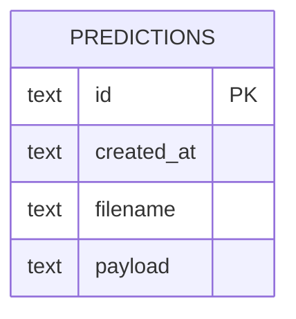

# Lưu trữ — Web kiểm tra chai nhựa

Lịch sử dự đoán của ứng dụng web dùng SQLite tại `data/web/history.db`. Mỗi lần kiểm tra lưu một bản ghi trong bảng `predictions` và một ảnh JPEG trong `data/web/images/`.

## Bảng predictions

| Cột | Kiểu | Nội dung |
| --- | --- | --- |
| `id` | TEXT, PRIMARY KEY | UUID của lần kiểm tra |
| `created_at` | TEXT, NOT NULL | Thời điểm ISO 8601 UTC |
| `filename` | TEXT, NOT NULL | Tên ảnh tải lên, đã bỏ thành phần đường dẫn |
| `payload` | TEXT, NOT NULL | JSON chứa kết quả và thông tin mô hình |



`payload` lưu `label`, `raw_label`, `confidence`, `probabilities`, `model`, `model_name`, `run_id`, `latency_ms`, ngưỡng phân loại, ngưỡng tin cậy và URL ảnh. Nhãn hiển thị nhận giá trị `normal`, `defect` hoặc `uncertain`; hai phần tử của `probabilities` theo thứ tự ý nghĩa bình thường/có lỗi.

Ảnh được đặt tên bằng `id`, theo dạng `data/web/images/<id>.jpg`. API chỉ trả ảnh khi bản ghi tương ứng còn tồn tại. Xóa một bản ghi sẽ xóa cả ảnh của lần kiểm tra đó.

## Mô hình và dữ liệu

Mô hình được lưu trên hệ thống tệp, không có bảng SQL riêng:

```text
models/trained/
  latest.json                  run_id đang được sử dụng
  training_progress.json       trạng thái huấn luyện
  <run_id>/
    svm.joblib
    random_forest.joblib
    mobilenet.pt
    report.json                cấu hình, chỉ số validation/test và đường học
    end_to_end.json            dự đoán từ ảnh đầy đủ, gồm yêu cầu chụp lại
```

`run_id` trong lịch sử cho biết lần huấn luyện đã tạo kết quả đó. Đây là liên kết thông tin với thư mục mô hình, không phải khóa ngoại SQLite. `latest.json` chỉ được cập nhật khi cả ba mô hình và báo cáo đã lưu thành công.

`data/training/manifest.json` mô tả ảnh gốc, `training_path` tới vùng chai tự tìm, nhãn, nhóm và Train/Validation/Test. Tên tệp và nhãn nguồn chỉ dùng quản lý dữ liệu; phần dự đoán nhận nội dung ảnh. Bộ nhớ đệm vùng chai và thông tin định vị nằm trong `data/training/crops/` và `crop_index.json`.

## Dữ liệu phiên bản trước

`data/inspection.db` và ảnh kết quả của giao diện Tkinter được giữ nguyên. Ứng dụng web không đọc hoặc xóa lịch sử so sánh ảnh cũ; lịch sử web được lưu riêng trong `data/web/`.
