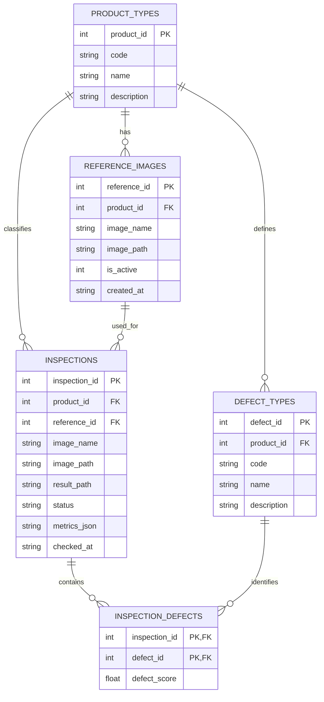

# ERD - CHƯƠNG TRÌNH KIỂM TRA LỖI 3 SẢN PHẨM

## Các thực thể

### PRODUCT_TYPES
- `product_id` - PK
- `code` - mã loại sản phẩm: HOE/BOTTLE/TILE
- `name` - Cuốc sắt/Chai nhựa/Gạch men
- `description`

### REFERENCE_IMAGES
- `reference_id` - PK
- `product_id` - FK -> PRODUCT_TYPES.product_id
- `image_name`
- `image_path`
- `is_active`
- `created_at`

### INSPECTIONS
- `inspection_id` - PK
- `product_id` - FK -> PRODUCT_TYPES.product_id
- `reference_id` - FK -> REFERENCE_IMAGES.reference_id
- `image_name`
- `image_path`
- `result_path`
- `status` - ĐẠT/KHÔNG ĐẠT
- `metrics_json` - các chỉ số xử lý ảnh của từng sản phẩm
- `checked_at`

### DEFECT_TYPES
- `defect_id` - PK
- `product_id` - FK -> PRODUCT_TYPES.product_id
- `code`
- `name`
- `description`

### INSPECTION_DEFECTS
- `inspection_id` - PK, FK -> INSPECTIONS.inspection_id
- `defect_id` - PK, FK -> DEFECT_TYPES.defect_id
- `defect_score`

## Quan hệ
- PRODUCT_TYPES 1 --- N REFERENCE_IMAGES
- PRODUCT_TYPES 1 --- N INSPECTIONS
- PRODUCT_TYPES 1 --- N DEFECT_TYPES
- REFERENCE_IMAGES 1 --- N INSPECTIONS
- INSPECTIONS N --- N DEFECT_TYPES thông qua INSPECTION_DEFECTS

## Mermaid ERD

## Giải thích thiết kế
Thiết kế này dùng chung một database cho cả 3 sản phẩm. Mỗi lần kiểm tra biết rõ thuộc loại sản phẩm nào, dùng ảnh chuẩn nào, kết quả ra sao và phát hiện những lỗi nào. Bảng trung gian INSPECTION_DEFECTS cho phép một lần kiểm tra có nhiều lỗi cùng lúc.
